<p align="center">
  
</p>

<h1 align="center">Edodocs</h1>

<p align="center"><b>Atos no e-docs e no Diário Oficial, em massa e sem retrabalho</b><br>
Prefeitura de Uberlândia</p>

---

## Por que o Edodocs existe

O Edodocs é uma **releitura do sistema antigo** em que os atos da Prefeitura eram feitos. Nele, cada portaria, decreto, nomeação ou exoneração era montado **um por um**: copiar os dados da planilha, colar no Word, abrir o e-docs, preencher o formulário, escolher vistos e assinantes, enviar, depois repetir tudo no Diário Oficial e, por fim, procurar nas edições se o ato saiu publicado.

O Edodocs mantém o mesmo caminho oficial (e-docs → Diário Oficial), mas muda a forma de trabalhar:

- **Envio em massa.** Uma planilha com 50 pessoas vira 50 atos no e-docs com um clique. Vistos, assinantes e anexos são escolhidos uma vez só e valem para todos.
- **Feito para quem só sabe Excel.** Tudo é configurado por listas e botões, sem fórmulas, sem código e sem mexer em arquivos escondidos.
- **Processos que antes eram lentos ficam rápidos.** O ato é montado sozinho a partir de um Word modelo e já sai no padrão do e-docs. Quem lançou, quando foi ao Diário e se já foi publicado aparece numa tabela com bolinhas coloridas.
- **Menos erros.** Campos obrigatórios são conferidos antes do envio, os dados que faltam são completados por tabelas de consulta e nada é cancelado ou sobrescrito no e-docs sem confirmação.

> Todos os prints abaixo usam **dados fictícios**.
>
> **Sobre esta versão pública:** é o código do Edodocs para portfólio. Os processos reais (modelos Word e planilhas), as gravações de tráfego dos sites usadas em alguns testes e qualquer dado de servidor foram retirados. Nomes, CPFs e matrículas que aparecem no código e nos testes são fictícios.

---

## Sumário

1. [Atos: a planilha que vira atos](#1-atos-a-planilha-que-vira-atos)
2. [Execução: acompanhar o envio](#2-execução-acompanhar-o-envio)
3. [Ato manual: escrever um ato sem planilha](#3-ato-manual-escrever-um-ato-sem-planilha)
4. [Caixa de Saída: vistos e cientes em lote](#4-caixa-de-saída-vistos-e-cientes-em-lote)
5. [Diário Oficial: conferir a publicação](#5-diário-oficial-conferir-a-publicação)
6. [Processos: cada tipo de ato do seu jeito](#6-processos-cada-tipo-de-ato-do-seu-jeito)
7. [Configurações](#7-configurações)
8. [Manual dentro do app](#8-manual-dentro-do-app)
9. [Modo escuro](#9-modo-escuro)
10. [Instalar e rodar](#10-instalar-e-rodar)

---

## 1. Atos: a planilha que vira atos

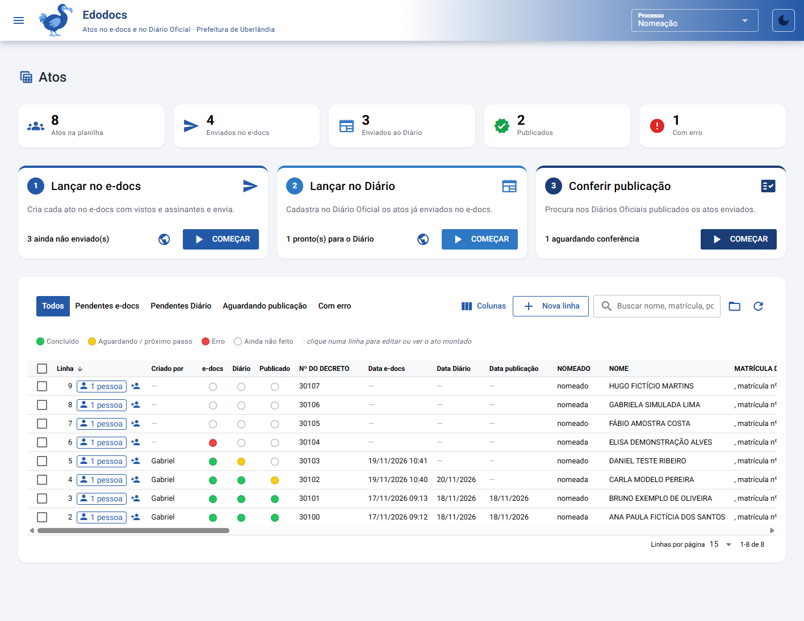

É a página principal. Cada linha da planilha do processo é um ato, e o trabalho é feito em **três passos**:

| Passo | O que faz |
|---|---|
| **1 · Lançar no e-docs** | Cria cada ato no e-docs com o texto montado a partir do Word modelo, coloca os vistos, os assinantes, os destinatários e os anexos, e envia. |
| **2 · Lançar no Diário** | Cadastra no Diário Oficial os atos que já foram enviados no e-docs. |
| **3 · Conferir publicação** | Procura nas edições publicadas do Diário Oficial e marca na planilha os atos que já saíram. |

O que mais a página oferece:

- **Contadores no topo:** quantos atos há na planilha, quantos foram enviados, quantos foram ao Diário, quantos foram publicados e quantos deram erro.
- **Bolinhas de status** em cada linha (🟢 concluído, 🟡 aguardando, 🔴 erro, ⚪ ainda não feito) para e-docs, Diário e publicação.
- **Coluna "Criado por":** o primeiro nome da conta do e-docs que lançou o ato. Assim se sabe quem enviou o quê.
- **Filtros rápidos:** Todos, Pendentes e-docs, Pendentes Diário, Aguardando publicação, Com erro.
- **Busca** por nome, matrícula ou qualquer coluna.
- **Nova linha e edição da linha sem abrir o Excel.** Os campos são completados sozinhos pelas tabelas de consulta (ex.: digita a matrícula e o nome, o cargo e o núcleo aparecem).
- **Várias pessoas no mesmo ato** (comissões, grupos): o botão "pessoa" agrupa linhas num ato só.
- **Ações em várias linhas:** marque as linhas e envie, refaça ou desfaça em lote.
- **Escolher colunas** que aparecem na tabela, e ver o ato montado antes de enviar.

---

## 2. Execução: acompanhar o envio

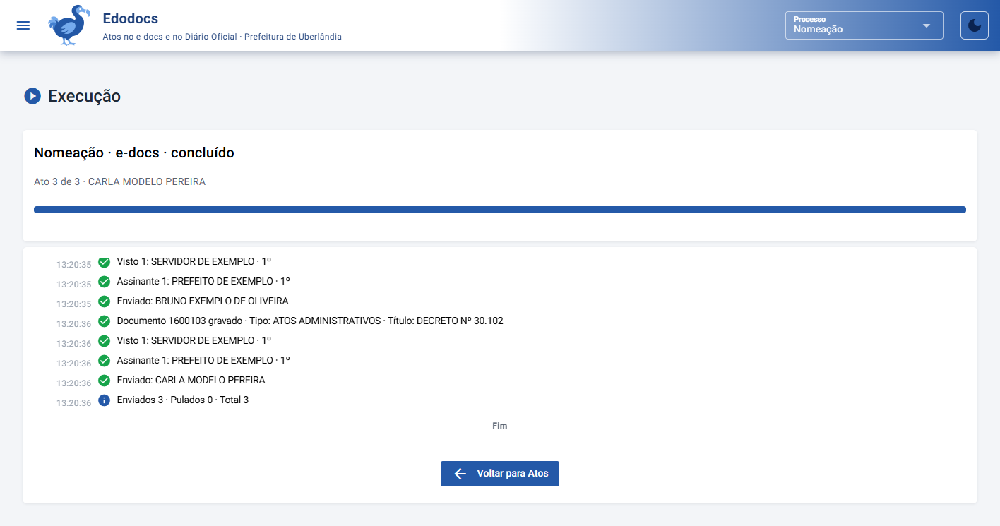

Enquanto o Edodocs trabalha, a página **Execução** mostra cada passo em tempo real: login, documento gravado, vistos, assinantes e envio, com uma barra de progresso ("Ato 3 de 3") e um resumo no fim (enviados, pulados, total).

Se o processo pede, o app **pergunta antes de cada ato**. Também pode enviar um atrás do outro, sem parar. Atos que já foram enviados são pulados sozinhos, então nada sai duplicado.

---

## 3. Ato manual: escrever um ato sem planilha

Para os atos avulsos que não vêm de uma planilha.

### Escolher o tipo de documento

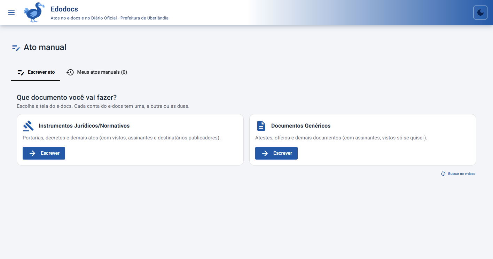

Cada conta do e-docs tem acesso a uma tela, à outra ou às duas. O Edodocs descobre sozinho quais a conta pode usar:

- **Instrumentos Jurídicos/Normativos:** portarias, decretos e demais atos, com vistos, assinantes e destinatários publicadores.
- **Documentos Genéricos:** atestes, ofícios e demais documentos, com assinantes. Os vistos só entram se você quiser.

### Escrever o documento

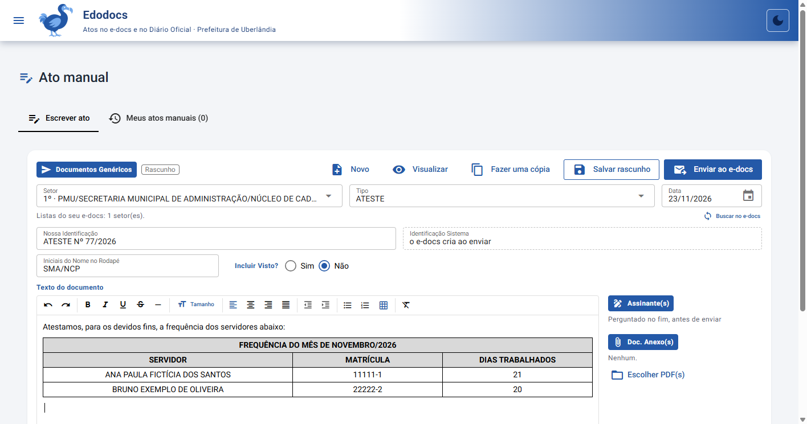

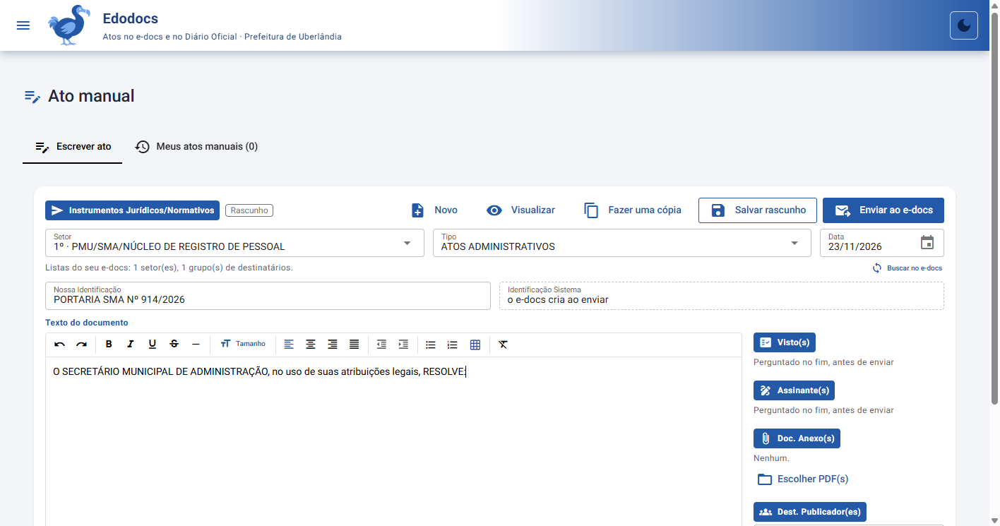

- **Setor, tipo e grupos vêm do próprio e-docs**, buscados com a conta de cada pessoa. A lista é a mesma que ela veria no site.
- **Editor de texto completo:** negrito, itálico, alinhamento, listas, tabelas e **tamanho da letra de 6 a 36 pt**.
- **Colar tabela do Excel:** a tabela chega como foi copiada, com bordas, mesclagens, alinhamento, larguras e o tamanho da letra de cada célula. Ela é ajustada ao formato que o e-docs aceita, então o PDF gerado fica igual ao feito direto no site.
- **Visualizar** o documento como vai ficar, **salvar rascunho**, **fazer uma cópia** e anexar PDFs.

### Meus atos manuais: envio de vários de uma vez

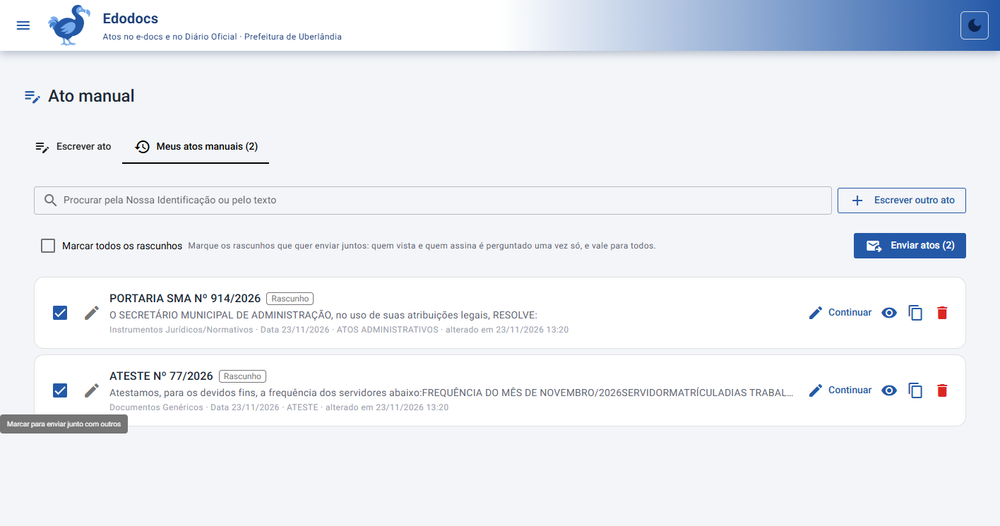

Os rascunhos ficam guardados. Marque vários e clique em **Enviar atos**: quem vista e quem assina é perguntado **uma vez só** e vale para todos. A busca procura pela identificação ou pelo texto.

---

## 4. Caixa de Saída: vistos e cientes em lote

| Cards | Lista |
|---|---|
| 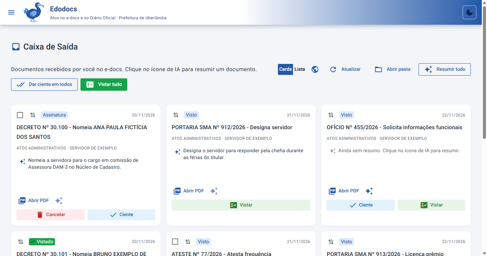 | 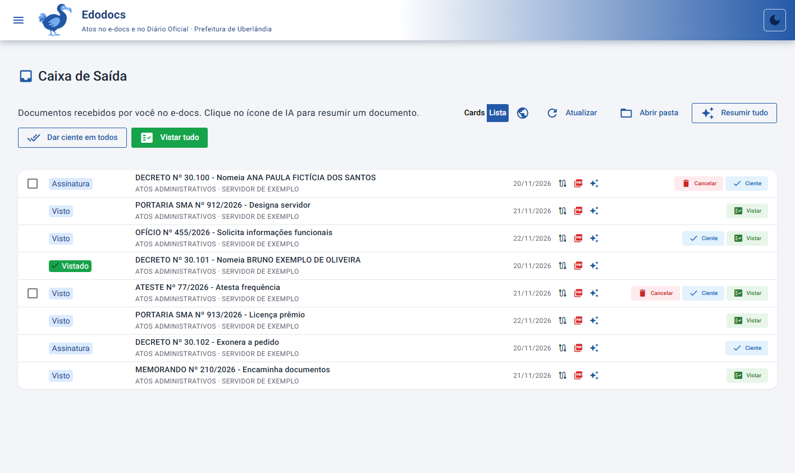 |

Mostra os documentos que chegaram para você no e-docs. Antes era preciso abrir um por um no site.

- **Dois modos de ver:** **Cards**, com mais detalhe, ou **Lista**, uma linha por documento, para ver muitos de uma vez. O app lembra o modo escolhido.
- **Vistar tudo** e **Dar ciente em todos** com um clique, ou documento por documento.
- **Cancelar** os documentos que você mesmo enviou (sempre com confirmação).
- **Abrir o PDF** e ver a **tramitação** sem sair do app.
- **Resumo por inteligência artificial:** um clique resume o documento em uma ou duas frases, para decidir rápido o que vistar.

---

## 5. Diário Oficial: conferir a publicação

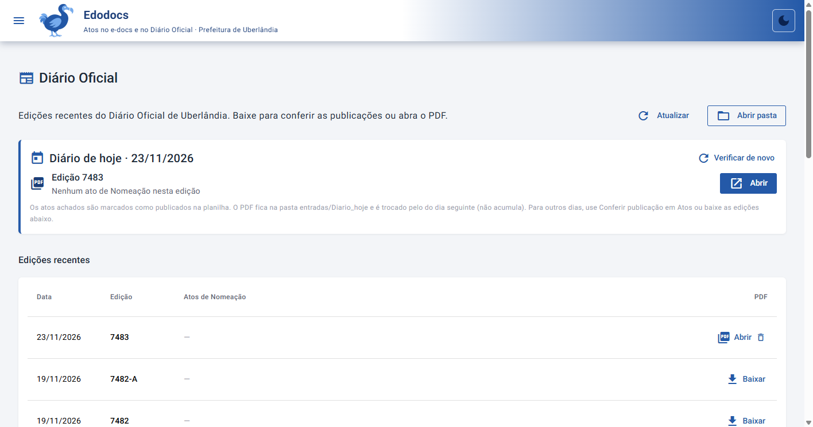

- **Diário de hoje:** o app procura sozinho a edição do dia, baixa o PDF e diz quais atos do processo saíram nela. Cada ato aparece com o nome do processo entre parênteses, por exemplo *(Nomeação)* ou *(Exoneração)*. Os atos achados são marcados como publicados na planilha.
- **Edições recentes:** a lista das últimas edições, para baixar ou abrir o PDF.

---

## 6. Processos: cada tipo de ato do seu jeito

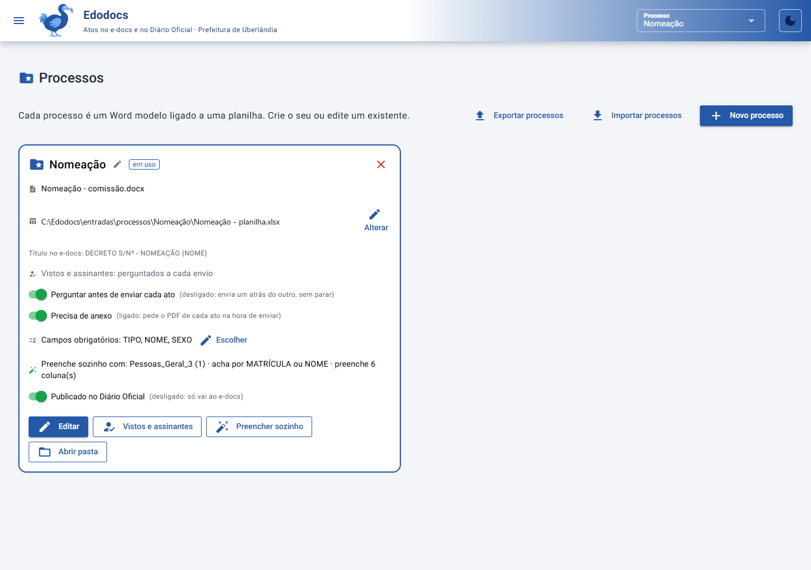

Um **processo** é um tipo de ato (Nomeação, Exoneração, Portaria – Designa, Licença Prêmio…): **um Word modelo ligado a uma planilha**. Cada processo tem as suas regras, sem programar nada:

- **Título no e-docs** montado com os campos da planilha (ex.: `DECRETO S/Nº - NOMEAÇÃO {NOME}`).
- **Vistos e assinantes** fixos ou perguntados a cada envio.
- **Perguntar antes de enviar cada ato**, **precisa de anexo** e **publicado no Diário Oficial**: liga e desliga.
- **Campos obrigatórios,** conferidos antes do envio.
- **Preencher sozinho:** liga o processo a uma tabela de consulta (ex.: cadastro de pessoas). Pela matrícula ou pelo nome, o app completa cargo, núcleo, secretaria etc.
- **De-para:** traduz códigos em descrições (ex.: lotação `0312` vira "Secretaria Municipal de Governo").
- **Criar processo novo com o assistente** ou **montar com IA** a partir de um Word já pronto.
- **Exportar e importar processos** para levar a outro computador.

---

## 7. Configurações

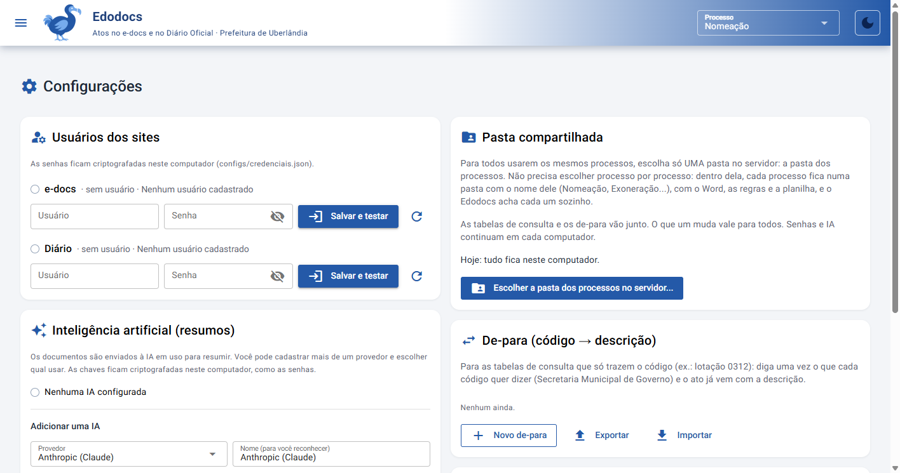

- **Usuários dos sites:** CPF e senha do e-docs e do Diário Oficial, **guardados criptografados** neste computador, com teste de login.
- **Pasta compartilhada:** escolha uma pasta no servidor e **todos os computadores passam a usar os mesmos processos, a mesma planilha e as mesmas tabelas**. O que um muda vale para todos. Senhas e IA continuam em cada computador.
- **Inteligência artificial:** cadastre um ou mais provedores e escolha qual usar. As chaves também ficam criptografadas.
- **Tabelas de consulta e de-para.**

---

## 8. Manual dentro do app

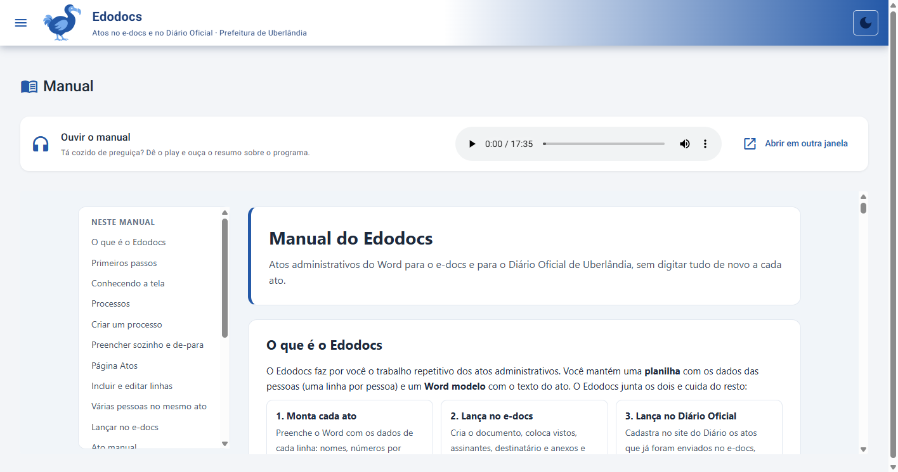

O manual completo fica dentro do próprio Edodocs, escrito para quem não é da área de tecnologia. Ele vai dos primeiros passos até "quando algo não sai certo".

---

## 9. Modo escuro

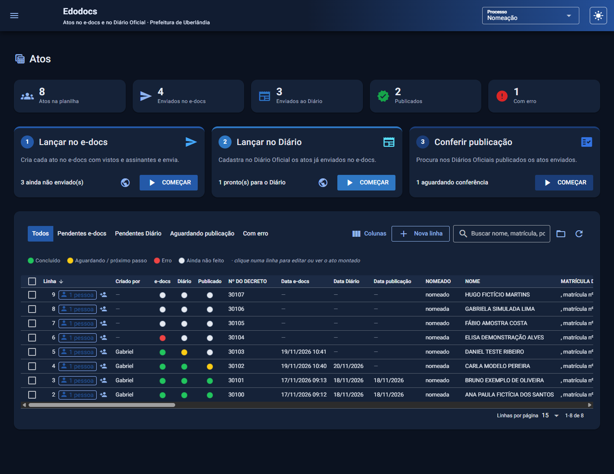

Um clique no botão do canto superior direito troca entre o modo claro e o escuro.

---

## 10. Instalar e rodar

### Para usar (computador da Prefeitura)

Descompacte o `Edodocs.zip` e abra o **Edodocs.exe**. Não precisa instalar Python nem mais nada.

> ⚠️ O pacote pode levar planilhas com dados pessoais de servidores. Compartilhe apenas por canais internos.

### Para desenvolver

```bash
pip install -r requirements.txt
python app.py
```

### Gerar o pacote

```bash
python build.py          # gera pacotes/Edodocs.zip
```

### Estrutura

| Pasta / arquivo | Para que serve |
|---|---|
| `app.py` | Interface (NiceGUI + janela própria) |
| `main.py` | Planilhas, status, configurações, pasta compartilhada |
| `edocs_http.py` / `diario_http.py` | Conversa com o e-docs e com o Diário Oficial |
| `ato_manual.py` / `ato_manual_ui.py` | Ato manual (editor, rascunhos, envio) |
| `recebidos_ui.py` | Caixa de Saída |
| `processos.py` | Processos (Word modelo + planilha + regras) |
| `entradas/processos/` | Um processo por pasta (Word, `processo.json`, planilha) |
| `assets/manual/` | Manual mostrado dentro do app |
| `testes/` | Testes automáticos |

### Segurança e dados

- Senhas e chaves de IA ficam **criptografadas** em `configs/` e nunca vão para o repositório.
- Planilhas, Diários baixados e gravações de tráfego estão no `.gitignore`.
- Nada é cancelado nem sobrescrito no e-docs sem confirmação de quem está usando.
